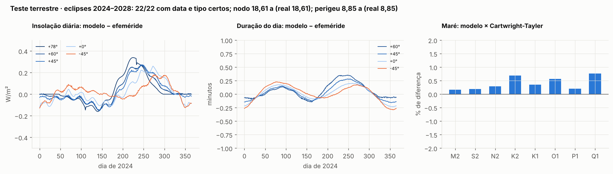
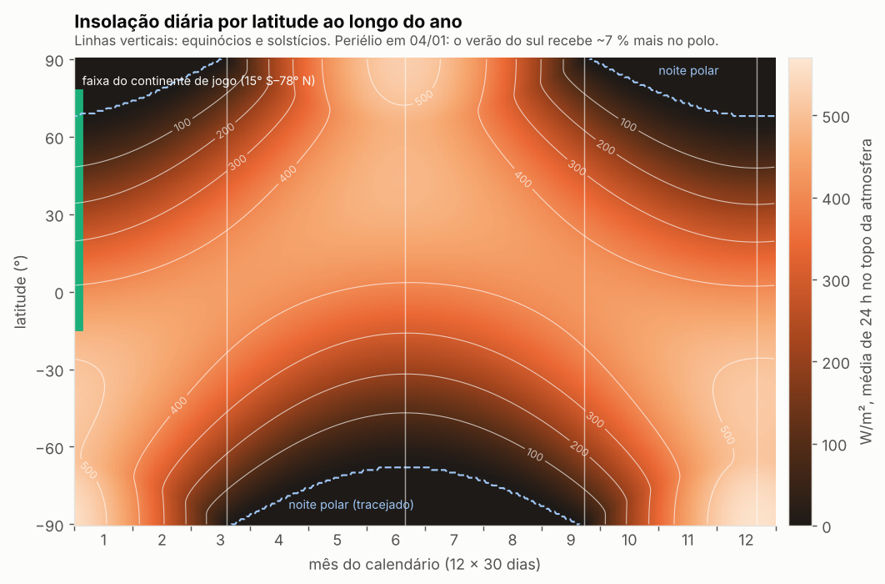
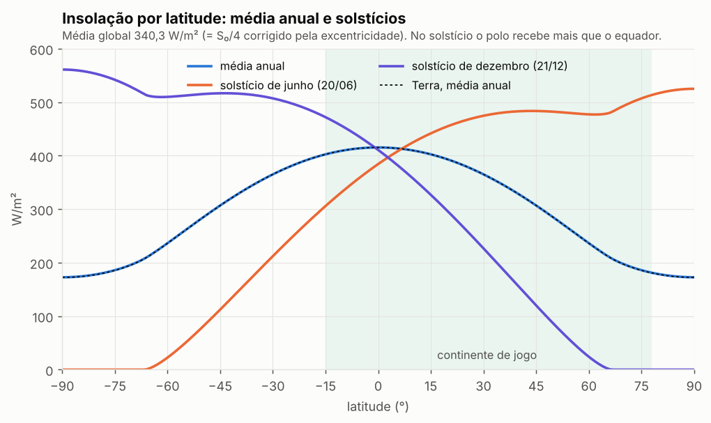
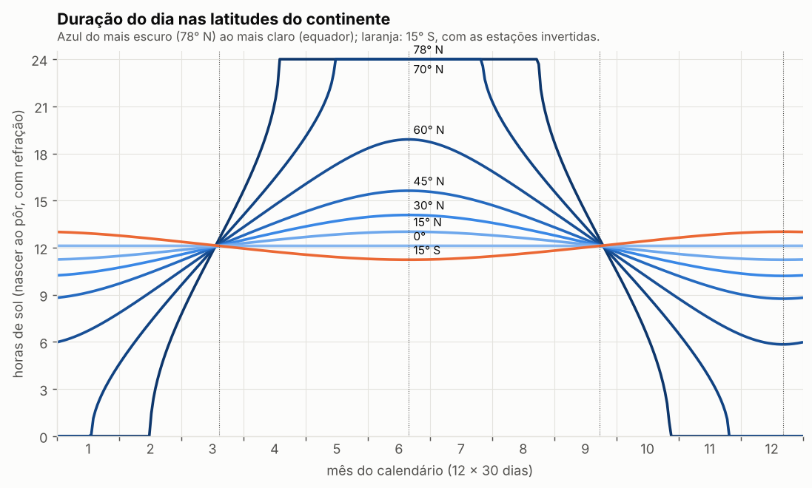
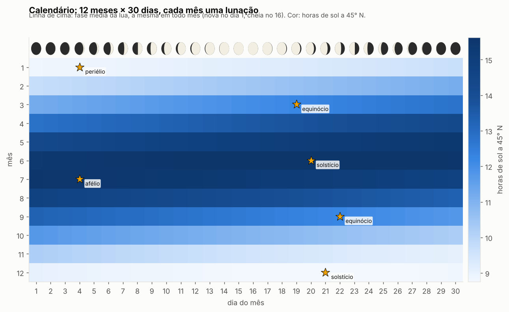
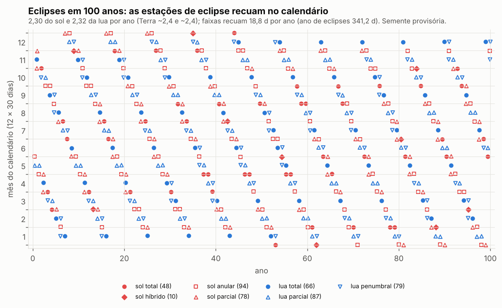
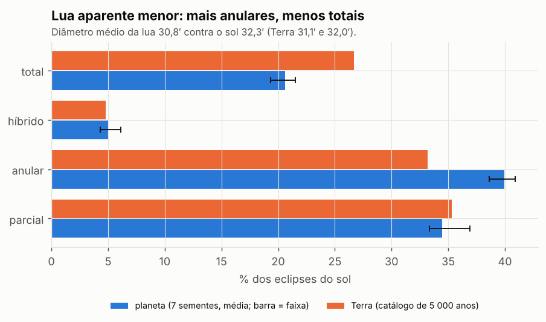
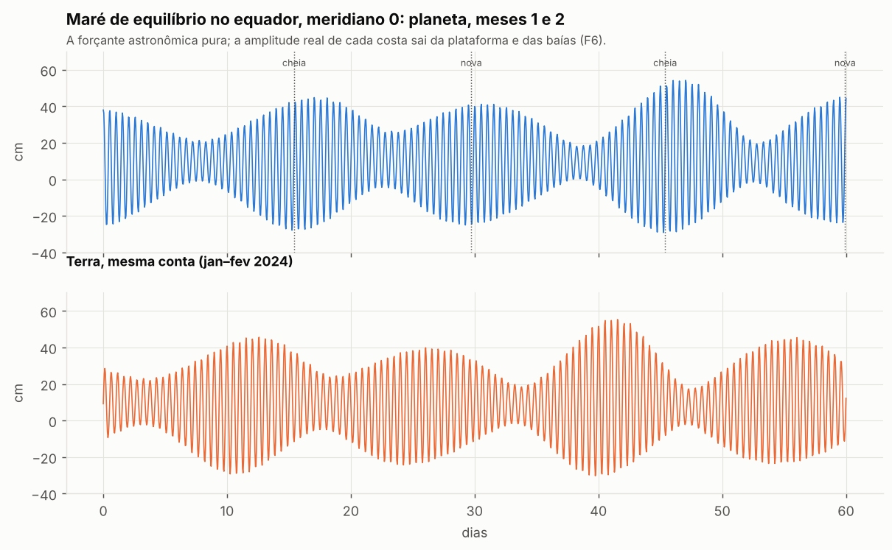
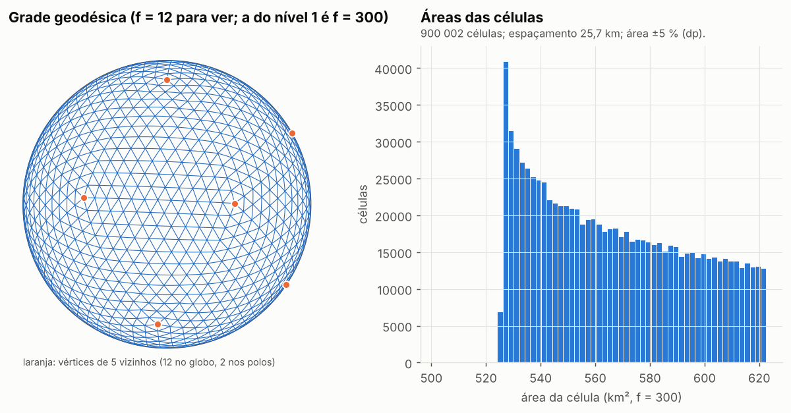

# F1 · Astros e globo — relatório

*Mundo v5 · plano rev. 1 (`docs/v5-0-plano.md`) · executada em 2026-10-28 · aguarda aprovação para seguir à F2.*

## Resumo

A F1 entrega a órbita, a insolação, a duração do dia, o calendário, a lua (fases, eclipses, maré) e a grade esférica do nível 1. **Todo módulo que podia rodar sobre a Terra rodou nela primeiro e a reproduziu** (princípio 8): insolação a ≤ 0,34 W/m² da efeméride real, duração do dia a < 1 min, os **22 eclipses reais de 2024–2028 com data e tipo certos**, nodo e perigeu da Lua a 0,03 %, amplitudes de maré a ≤ 1,2 % das tabelas clássicas, e a fração de terra da Terra (28,90 %) recuperada exatamente pela grade.

No planeta, nada foi ajustado para dar resultado, só para cumprir as decisões da seção 22 (ano de 360 d, lunação de 30 d, órbita da lua igual à nossa em forma). O que saiu, saiu: a lua fica 1 % mais longe, o sol aparente 1 % maior, e por isso **eclipses totais do sol são ~20 % mais raros que na Terra e os anulares mais comuns**; a maré lunar cai 3 % e a solar sobe 3 %; o ciclo do nodo é de 18,1 anos.

Quatro decisões de execução desta fase precisam do seu aval (seção 3 deste relatório).

---

## 1 · O que foi construído

| Módulo | Faz | Testado na Terra contra |
|---|---|---|
| `mundo/constantes.py` | parâmetros decididos + derivados por física (semieixo, luminosidade, mês sideral, precessão) | ano sideral, mês sideral, precessão reais |
| `mundo/orbita.py` | sol aparente: longitude, declinação, distância, equação do tempo; insolação diária e horária; duração do dia e crepúsculo | efeméride ERFA (astropy), 2024, 12 latitudes |
| `mundo/nbody.py` | problema de três corpos estrela-planeta-lua, integração direta (DOP853, tolerância 10⁻¹²) | estado real de 2024 integrado 19 anos |
| `mundo/lua.py` | fases, sizígias, eclipses do sol e da lua com geometria de sombra (umbra, penumbra, antiumbra, híbrido) | eclipses reais 2024–2028 (NASA) |
| `mundo/mare.py` | maré de equilíbrio (graus 2 e 3, lua e sol) e análise harmônica | constantes de Cartwright-Tayler-Edden |
| `mundo/grade.py` | grade geodésica icosaédrica, células de Voronoi, vizinhos, áreas | máscara terra/mar GLOBE 1 km |
| `mundo/sistema.py` | monta o sistema do planeta a partir das decisões; âncoras do calendário | — |
| `mundo/semente.py` | semente única → fluxos nomeados por módulo e por bloco | determinismo (testes) |

Scripts: `scripts/terra_a_insolacao.py`, `terra_b_lua.py`, `terra_c_grade.py` (teste terrestre); `planeta_a_lua_mare.py`, `planeta_b_insolacao_calendario.py` (planeta); `f1_graficos.py`; `f1_manifesto.py`. Testes rápidos: `python3 -m pytest tests` (8 testes, verdes).

A lua não usa teoria lunar pronta: regressão do nodo, precessão do perigeu, evecção, variação e equação anual **saem da gravidade da estrela sobre o par planeta-lua**. Por isso o mesmo código vale para a Terra e para o planeta, e o teste terrestre testa a física, não uma tabela.

---

## 2 · Teste terrestre (princípio 8)

### A · Insolação, duração do dia, equação do tempo
Modelo com os parâmetros da Terra × integração numérica do sol real (astropy/ERFA, passo de 5 min), ano de 2024, latitudes de 60° S a 78° N.

| Grandeza | Diferença máxima | Comentário |
|---|---|---|
| Insolação diária no topo da atmosfera | **0,34 W/m²** (0,07 %) | em todas as latitudes e dias |
| Insolação média anual no equador | 415,59 × 415,57 W/m² | |
| Duração do dia (|lat| ≤ 66°) | **0,67 min** | refração e semidiâmetro (−0,833°) |
| Duração do dia no primeiro/último dia de sol polar (70°, 78°) | 12 e 35 min | o modelo usa a declinação do meio-dia; nesses dias o sol mal toca o horizonte. Não afeta contagem de dias polares em mais de 1 dia |
| Equação do tempo | **0,15 min** | real +16,5/−14,3 min; modelo +16,4/−14,2 |

### B · Lua, eclipses e maré (três corpos)
Estado do Sol, Terra e Lua em 2024-01-01 (ERFA), integrado 19 anos. O estado inicial da Lua foi refinado por mínimos quadrados às posições ERFA dos primeiros 120 dias (a velocidade embutida é aproximada) e testado **fora da amostra**.

| Grandeza | Modelo | Terra real |
|---|---|---|
| Posição da Lua, dia 120 ao ano 5 | erro médio 9,6″, máx. 26″ | — |
| Mês sinódico médio | 29,53053 d | 29,53059 d |
| Período do nodo | 18,608 anos | 18,613 |
| Período do perigeu | 8,847 anos | 8,849 |
| Excentricidade / inclinação (média dos osculadores) | 0,0556 / 5,154° | elementos médios clássicos: 0,0549 / 5,145° |
| **Eclipses 2024–2028** | **22 de 22 com data e tipo certos, nenhum a mais** | lista NASA |
| M2, S2, N2, K2 (equador) | razão 1,002 / 1,002 / 1,003 / 1,007 | Cartwright-Tayler-Edden |
| K1, O1, P1, Q1 (45°) | razão 1,004 / 1,006 / 1,002 / 1,008 | idem |

Os eclipses reproduzidos incluem os quatro tipos do sol (total de 8/abr/2024, anular de 2/out/2024, parciais de 2025) e os três da lua (penumbral, parcial, total). Lista completa em `dados/f1/terra/resumo_lua_mare.json`.

### C · Grade sobre a Terra
A máscara terra/mar de 1 km da Terra (GLOBE) amostrada nos 900 002 centros de célula, pesando por área, dá **28,90 % de terra — igual à da própria máscara integrada a 0,05° com peso cos(lat) (28,90 %)**. Sem peso, numa grade lat/lon, daria 33,2 %: é o erro que a grade evita. Integrais de harmônicos esféricos que devem dar zero dão < 10⁻¹⁶.

**Veredito:** todos os módulos reproduzem a Terra em forma e em número. Liberados para o planeta.

---

## 3 · Decisões de execução desta fase (pedem aprovação)

As decisões da seção 22 foram aplicadas sem mudança. Onde elas não fixavam algo, ou fixavam duas coisas que a física liga, decidi assim:

1. **Estrela e distância.** Ano de 360 d com estrela de 1 massa solar dá semieixo de 0,9904 UA (Kepler). O fluxo igual ao da Terra (1 361 W/m² no semieixo) então pede luminosidade de **0,981 L☉** (Teff ≈ 5 744 K, ainda tipo solar G2). Alternativa equivalente: 1,029 M☉ a 1 UA — a maré solar sairia igual, porque ela só depende do período. Consequência visível: sol aparente de 32,3′ (Terra 32,0′).
2. **Lua: distância sai da lunação.** "Do tamanho e distância da nossa" + "lunação de 30 dias" não cabem juntos exatamente; a lunação é decisão explícita, a distância vira consequência: **388 460 km de média** (+1,1 %). A forma da órbita (excentricidade e inclinação médias) foi igualada à da Lua real medida pelo mesmo método no teste B. Nodo e perigeu iniciais vêm da semente.
3. **Calendário ancorado.** Ano civil = ano trópico de exatamente 360 d (sem bissexto, não deriva); lunação média exatamente 30 d, **lua nova média à 00:00 do dia 1 de cada mês**; solstício de dezembro ao meio-dia de **21/12**, como no gregoriano; periélio com a mesma longitude da Terra de hoje (282,94°), que cai em **04/01**. Hora = tempo solar médio no meridiano 0. A comensurabilidade exata ano/lunação é uma decisão de mundo (num planeta real derivaria em milhões de anos por maré; irrelevante na escala do jogo).
4. **Grade do nível 1: icosaédrica, f = 300.** 900 002 células de ~567 km², espaçamento médio 25,7 km (23,5–27,7), 12 pentágonos (dois nos polos). Pontos postos na esfera por interpolação "slerp" baricêntrica: área ±5 % (a gnomônica daria ±13 % e razão 2,0 entre maior e menor célula; esta dá 1,24). As grades f = 75 (~100 km) e f = 150 (~51 km) são subconjuntos exatos dela, úteis para rodadas grossas da F2. A grade não é versionada (regenera em 16 s; o hash SHA-256 está no manifesto).

**Semente.** A F1 usou a semente provisória 0 (só afeta nodo e perigeu iniciais da lua, portanto as datas dos eclipses). A semente do planeta é escolhida na F2/F7; as tabelas de eclipses serão refeitas com ela. Seis sementes extras mostram que a forma não depende dela (seção 4.5).

---

## 4 · O planeta

### 4.1 · Astros

| Item | Planeta | Terra |
|---|---|---|
| Ano trópico / sideral | 360 / 360,0136 d | 365,2422 / 365,2564 d |
| Semieixo | 0,9904 UA (148,16 M km) | 1 UA |
| Fluxo médio no topo (média global) | 340,3 W/m² | 340,3 W/m² |
| Dia solar / sideral | 24 h / 23 h 56 min 00,7 s | 24 h / 23 h 56 min 04,1 s |
| Precessão do eixo (derivada) | 26 390 anos (49,1″/ano) | 25 772 (50,3″/ano) |
| Lunação / mês sideral / draconítico / anomalístico | 30,000 / 27,692 / 27,575 / 27,948 d | 29,531 / 27,322 / 27,212 / 27,555 d |
| Dia lunar (maré) | 24 h 49,7 min | 24 h 50,5 min |
| Distância média da lua (perigeu–apogeu extremos) | 388 460 km (359 160–410 420) | 384 400 (356 400–406 700) |
| Diâmetro aparente lua / sol (médios) | 30,8′ / 32,3′ | 31,1′ / 32,0′ |
| Período do nodo / do perigeu | 18,12 / 8,42 anos | 18,61 / 8,85 anos |
| Ano de eclipses | 341,2 d | 346,6 d |

A precessão é calculada pelo torque de estrela e lua no bojo equatorial; a mesma fórmula dá 25 771 anos para a Terra (real 25 772).

### 4.2 · Insolação e estações

| Marco | Data (dia/mês hh:mm) |
|---|---|
| Periélio | 04/01 00:13 |
| Equinócio de março | 19/03 04:13 |
| Solstício de junho | 20/06 15:03 |
| Afélio | 04/07 00:13 |
| Equinócio de setembro | 22/09 23:21 |
| Solstício de dezembro | 21/12 12:00 |

Estações do norte: primavera 91,5 d, **verão 92,3 d**, outono 88,5 d, **inverno 87,7 d** — o verão do norte é 4,7 d mais longo e um pouco menos intenso, o do sul mais curto e mais forte (no polo sul o pico diário é 561 W/m² contra 525 no polo norte, +7 %). É o "estações do norte e do sul diferem um pouco" da seção 3, com o mesmo tamanho que na Terra.

- Média anual: 415,5 W/m² no equador, 172,8 nos polos. No solstício, o polo de verão recebe mais por dia que o equador (dia de 24 h).
- Diferença para a Terra no mesmo ponto do ano: no máximo 1,7 W/m² (obliquidade 23,5° × 23,44°, excentricidade 0,017 × 0,0167). Gráfico `f1_02`.

### 4.3 · Duração do dia e dias polares

| Latitude | Dia mais longo | Dia mais curto | Dias de sol 24 h | Dias sem sol | Dias sem crepúsculo civil |
|---|---|---|---|---|---|
| 78° N (limite norte) | 24 h | 0 h | 125 | 109 | 76 |
| 70° N | 24 h | 0 h | 71 | 52 | 0 |
| 60° N | 18 h 54 min | 5 h 51 min | 0 | 0 | 0 |
| 45° N | 15 h 38 min | 8 h 45 min | 0 | 0 | 0 |
| 30° N | 14 h 05 min | 10 h 12 min | 0 | 0 | 0 |
| 0° | 12 h 07 min | 12 h 07 min | 0 | 0 | 0 |
| 15° S (limite sul) | 13 h 01 min | 11 h 14 min | 0 | 0 | 0 |

No extremo norte do continente há quatro meses de sol da meia-noite e mais de três meses sem nascer do sol, dos quais dois e meio sem nem crepúsculo civil — luz de viagem medieval muito curta. Com refração, o sol da meia-noite começa em 65,7° (abaixo do círculo polar de 66,5°).

Também: `f1_05` (dias/noites polares por latitude), `f1_06` (insolação hora a hora nas quatro datas), `f1_07` (equação do tempo de −14,4 a +16,6 min e analema).

### 4.4 · Calendário

12 meses × 30 dias; o mês começa na lua nova média; **lua cheia média no dia 16**, quartos nos dias 8–9 e 23–24, em todo mês de todo ano. A lua verdadeira oscila **±14 h** em torno da média (órbita excêntrica), sem deriva em 100 anos (mês sinódico médio integrado 30,0000002 d). Calendário diário completo, com fase, declinação, equação do tempo, duração do dia e insolação em oito latitudes, em `dados/f1/planeta/calendario.csv`.

Os meses não têm nome: nomes e eras são do povoamento (fora deste plano).

### 4.5 · Lua e eclipses

A lua sobe a 28,8° de declinação nos anos de paralisação maior e só a 18,2° nos de menor, num ciclo de 18,1 anos (`f1_10`). Distâncias e evecção em `f1_10b`.

Em 100 anos (semente provisória): **4 a 6 eclipses por ano**, 2,30 do sol e 2,32 da lua por ano — o mesmo ritmo da Terra. As estações de eclipse recuam 18,8 dias por ano no calendário.

| Eclipses do sol em 100 anos | total | híbrido | anular | parcial |
|---|---|---|---|---|
| Planeta, 7 sementes (faixa) | 45–49 | 10–14 | 89–94 | 75–86 |
| Planeta, % (média) | 20,6 % | 5,0 % | 39,9 % | 34,5 % |
| Terra, % (catálogo de 5 000 anos) | 27 % | 5 % | 33 % | 35 % |

Os eclipses da lua dividem-se em 29 % totais, 35 % parciais e 36 % penumbrais (média das 7 sementes), proporções próximas às da Terra. **Forma independente da semente; só as datas mudam.** A lua aparente menor (30,8′ contra 31,1′) contra um sol aparente maior (32,3′ contra 32,0′) torna o total do sol mais raro e o anular mais comum.

Tabelas: `fases_lua_100anos.csv` (4 800 fases com data e hora), `eclipses_100anos.csv` (tipo, data, γ em raios do planeta; na coluna `grandeza`, para a lua é a grandeza umbral — ou penumbral, se penumbral —, para o sol é a penetração da sombra no plano fundamental, >1 = central).

### 4.6 · Maré

Forçante de equilíbrio (oceano global sem inércia). Amplitudes reais de cada costa saem de plataforma e baías na F6.

| Constituinte | Período no planeta | Amplitude planeta | Terra (modelo) |
|---|---|---|---|
| M2 (lunar semidiurna) | 12,414 h | 23,6 cm | 24,3 cm |
| S2 (solar semidiurna) | 12,000 h | 11,6 cm | 11,3 cm |
| N2 (elíptica lunar) | 12,648 h | 4,5 cm | 4,7 cm |
| K2 | 11,967 h | 3,1 cm | 3,1 cm |
| K1 (45°) | 23,934 h | 14,2 cm | 14,2 cm |
| O1 (45°) | 25,791 h | 9,9 cm | 10,1 cm |
| P1 (45°) | 24,067 h | 4,8 cm | 4,7 cm |
| Q1 (45°) | 26,822 h | 1,9 cm | 1,9 cm |

Razão S2/M2 = 0,49 (Terra 0,47): **sizígia e quadratura um pouco mais contrastadas que na Terra.** No equador, a amplitude de equilíbrio vai de 27 a 46 cm na sizígia (média 37) e de 5 a 19 cm na quadratura (média 13); as sizígias de perigeu dão as maiores (correlação −0,81 entre distância da lua e amplitude; 41 cm em média com a lua a menos de 362 mil km, 32 cm acima de 405 mil). Como a lunação é de 30 d, **marés vivas caem sempre perto dos dias 1–2 e 16–17 de cada mês** e marés mortas perto dos dias 8–9 e 23–24 — útil para pescadores e portos do calendário.

### 4.7 · Grade

| f | Células | Espaçamento médio | Área (dp) | Uso sugerido |
|---|---|---|---|---|
| 75 | 56 252 | 103 km | ±5 % | rodada de sementes da F2 |
| 150 | 225 002 | 51 km | ±5 % | testes |
| **300** | **900 002** | **25,7 km** | ±5 % | **nível 1** |

---

## 5 · Checagens de coerência (forma, não meta)

| Checagem | Resultado |
|---|---|
| Teste terrestre de todos os módulos | passou (seção 2) |
| Média global de insolação = S₀/4 corrigido pela excentricidade | 340,30 W/m², igual à fórmula (teste) |
| Perfil de insolação por latitude no envelope terrestre | diferença ≤ 1,7 W/m² |
| Estações assimétricas no sentido certo (periélio no inverno do norte) | verão norte mais longo e mais fraco |
| Mês civil em fase com a lua por 100 anos | ±14 h, sem deriva |
| Frequência e mistura de eclipses em forma terrestre, estável entre sementes | sim; desvio (menos totais) explicado pela geometria |
| Nodo e perigeu da lua emergem da física, perto da Terra | 18,1 e 8,4 anos |
| Maré: M2 e S2 escalam com os períodos, como manda a física | −2,8 % e +2,9 % |
| Grade: soma das áreas = 4π, 12 pentágonos, aninhamento exato, determinismo | sim (testes) |

---

## 6 · Desvios da Terra e por quê

| Desvio | Motivo | Efeito |
|---|---|---|
| Ano de 360 d | decisão 3 | semieixo 0,9904 UA; luminosidade 0,981 L☉ |
| Lunação de 30 d | decisão 3 | lua a 388 460 km; maré lunar −3 %; ciclos do nodo e do perigeu mais curtos |
| Obliquidade 23,5° | decisão 1 | +0,06° de trópicos e círculos polares |
| Excentricidade 0,017 | decisão 2 | igual à Terra em forma |
| Ano e lunação comensuráveis exatos | decisão 3, leitura literal | calendário sem bissexto e sem deriva de fase |
| Totais do sol mais raros | consequência dos dois primeiros | 21 % dos eclipses do sol em vez de 27 % |

Nenhum desvio foi introduzido para obter resultado.

---

## 7 · O que fica para as próximas fases

- **F2:** a semente do planeta (os eclipses e fases datadas serão refeitos com ela); grades f = 75/150 prontas para a rodada de sementes.
- **F3:** insolação diária por latitude pronta para o balanço de energia (plano B) ou como forçante do plano A.
- **F4 (ciclos glaciais):** a precessão do eixo (26 390 anos) é derivada; a variação de excentricidade e obliquidade em 2 Ma depende de planetas vizinhos que o plano não define. Proposta para a F4: usar a solução orbital da Terra (Laskar) com a precessão reescalada, declarando o desvio.
- **F6:** forçante de maré por constituinte e as datas de marés vivas; a amplitude por costa sai da plataforma.

---

## 8 · Arquivos

- Plano: `docs/v5-0-plano.md`. Este relatório: `docs/f1-relatorio.md`.
- Gráficos: `out/f1/` — `f1_00` teste terrestre; `f1_01`–`f1_07` sol; `f1_08` calendário; `f1_09`–`f1_12` lua e eclipses; `f1_13`–`f1_14` maré; `f1_15` grade.
- Dados: `dados/f1/planeta/` (calendário, insolação diária 1°×dia, horária, duração do dia com e sem crepúsculo, dias polares, fases e eclipses de 100 anos, constituintes de maré, resumos JSON), `dados/f1/terra/` (resultados do teste terrestre), `dados/f1/manifesto.json` (SHA-256 de cada arquivo, parâmetros, versões e comandos para regenerar).
- Intermediários grandes (`_*.npz`) não são versionados; saem dos scripts.

**Para aprovação:** as quatro decisões da seção 3 (estrela de 0,981 L☉; distância da lua derivada; âncoras do calendário; grade icosaédrica f = 300). Com elas aprovadas, a F2 começa clonando o repositório, lendo o plano e este relatório.
